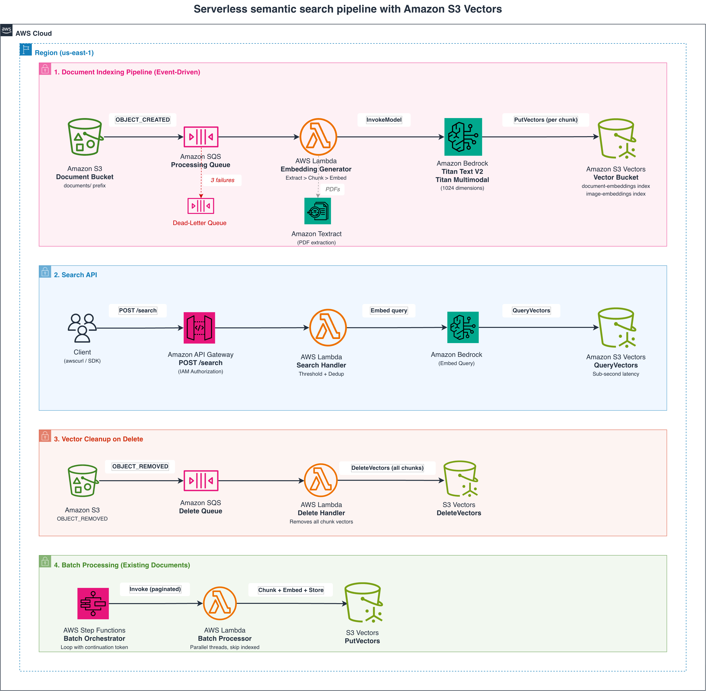
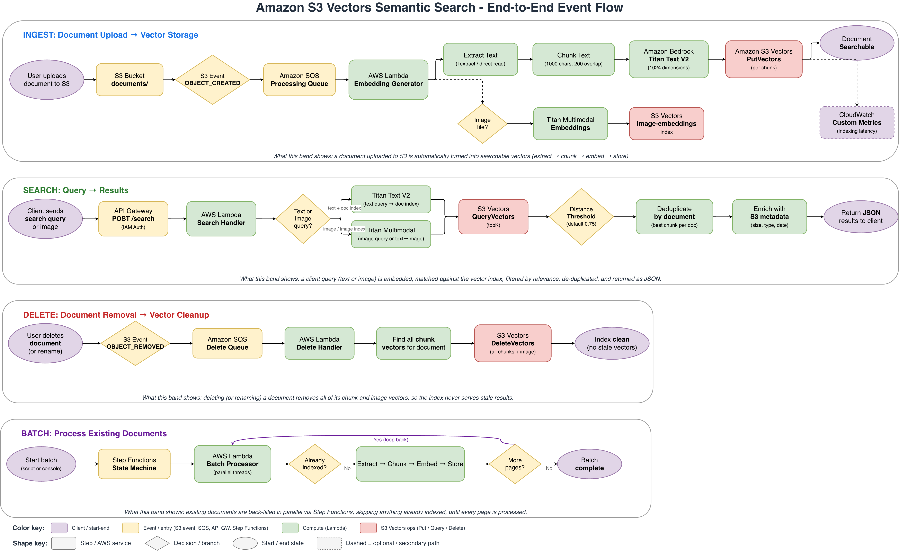

# Semantic Search with Amazon S3 Vectors and Amazon Bedrock

This repository contains the complete implementation code that accompanies the AWS blog post *Build semantic search over your Amazon S3 documents with S3 Vectors*.

It demonstrates how to build a fully serverless semantic search pipeline using Amazon S3 Vectors, Amazon Bedrock (Titan Embeddings V2), and AWS Lambda. Documents uploaded to Amazon S3 are automatically indexed - text is extracted, chunked into semantically meaningful segments, vector embeddings are generated, and stored in an S3 Vectors index for sub-second similarity search.

## Key Features

- **Intelligent chunking** - documents are split into overlapping chunks for fine-grained retrieval
- **Multi-modal search** - embed both text and images (e.g., damage photos in insurance claims)
- **Confidence thresholds** - filter out low-relevance results automatically
- **Document deduplication** - returns the best-matching chunk per document, not multiple chunks from the same file
- **Automatic sync** - vectors are created on upload, updated on re-upload, and deleted on removal
- **Batch backfill** - process existing document backlogs via Step Functions
- **Cost-optimized** - ~$7/month for 100K documents with 1,000 daily queries
- **Production-ready** - CloudWatch dashboard, custom metrics, DLQ, and e2e test suite

## Architecture



### Event Flow



### Component Summary

```
Document Upload → S3 Event → SQS → Lambda (Embedding Generator)
                                        ↓
                              Extract Text → Chunk → Embed (Bedrock Titan V2)
                                        ↓
                                   S3 Vectors (put_vectors) [per chunk]
                                        ↓
                              API Gateway → Lambda (Search)
                                              ↓
                         S3 Vectors (query_vectors) → Threshold → Deduplicate → Client

Document Delete → S3 Event → SQS → Lambda (Delete Handler)
                                        ↓
                          S3 Vectors (delete_vectors) [all chunks]

Image Upload → S3 Event → SQS → Lambda (Embedding Generator)
                                      ↓
                              Bedrock Titan Multimodal Embeddings
                                      ↓
                              S3 Vectors Image Index (put_vectors)
```

### Metadata pre-filtering

Searches in this pipeline combine semantic similarity with metadata filters (for example, `file_type` or a `document_key` prefix). With [metadata pre-filtering](https://aws.amazon.com/blogs/aws/amazon-s3-vectors-now-supports-metadata-pre-filtering-for-higher-recall-on-filtered-searches/), S3 Vectors evaluates the filter *before* the similarity search, so your `top_k` results come from the full matching subset. This gives higher recall on narrowly scoped queries - one claim folder, one policy type, one date range.

Pre-filtering is controlled by the index mode. Each index takes its default mode from the vector bucket, and you can change it per index with `UpdateIndexMode`:

- `CLASSIC` - metadata filters are evaluated in tandem with the vector search; narrow filters can return fewer than `top_k` results
- `ENHANCED` - metadata filters are evaluated before the vector search (pre-filtering)

**Vector buckets created on or after 2026-09-30 default to `ENHANCED`.** Because this stack creates a fresh vector bucket, its indexes are already in `ENHANCED` mode - there is nothing extra to configure. Verify after deploy with:

```bash
python code/scripts/check_index_mode.py $VECTOR_BUCKET
```

**Edge case - older bucket.** If you point this pipeline at a vector bucket created *before* 2026-09-30, its indexes use `CLASSIC` mode. Switch each existing index to `ENHANCED` with `UpdateIndexMode`. The change takes effect in place, with no re-ingestion and no changes to your queries:

```python
import boto3

s3vectors = boto3.client("s3vectors")
s3vectors.update_index_mode(
    vectorBucketName="<vector-bucket-name>",
    indexName="document-embeddings",
    indexMode="ENHANCED",
)
```

To make indexes you create later in that bucket default to `ENHANCED`, also call `put_vector_bucket_default_index_mode` with `defaultIndexMode="ENHANCED"`. Alternatively, a single `QueryVectors` request can set `queryMode="ENHANCED"` against a `CLASSIC` index, but this sample's search handler doesn't send `queryMode`, so `UpdateIndexMode` is the simpler fix. See [Vector index mode](https://docs.aws.amazon.com/AmazonS3/latest/userguide/s3-vectors-index-mode.html).

**Availability.** Metadata pre-filtering is available in commercial AWS Regions and China Regions. It is not yet available in AWS GovCloud (US) or ADC Regions. Confirm the feature has rolled out to your deployment Region before relying on it.

## AWS Services Used

| Service | Purpose |
|---------|---------|
| Amazon S3 | Source document storage |
| Amazon S3 Vectors | Vector embedding storage and similarity search (text + image indexes) |
| Amazon Bedrock | Embedding generation (Titan Text Embeddings V2 + Titan Multimodal) |
| Amazon Textract | Text extraction from PDFs |
| AWS Lambda | Event-driven document processing and search API |
| Amazon SQS | Event buffering with dead-letter queue |
| AWS Step Functions | Batch processing orchestration |
| Amazon API Gateway | REST API for search endpoint (IAM-authorized) |
| Amazon CloudWatch | Dashboard, custom metrics, and alarms |
| AWS CDK | Infrastructure as code |

## Prerequisites

- An [AWS account](https://aws.amazon.com/free/)
- [AWS CLI v2](https://docs.aws.amazon.com/cli/latest/userguide/getting-started-install.html) installed and configured
- [Python 3.11+](https://www.python.org/downloads/)
- [Node.js 18+](https://nodejs.org/) (required for AWS CDK)
- [AWS CDK v2](https://docs.aws.amazon.com/cdk/v2/guide/getting-started.html) (`npm install -g aws-cdk`)
- boto3 >= 1.43.108 (`pip install "boto3>=1.43.108"`) - first release with the S3 Vectors index-mode APIs used for metadata pre-filtering
- Amazon Bedrock model access enabled for:
  - `amazon.titan-embed-text-v2:0` (required - text embeddings)
  - `amazon.titan-embed-image-v1` (optional - multimodal image embeddings)
  - Go to the [Amazon Bedrock console](https://console.aws.amazon.com/bedrock/) → Model access → Request access

## Getting Started

### 1. Clone the repository

```bash
git clone https://github.com/aws-samples/sample-s3-vectors-insurance-claims.git
cd sample-s3-vectors-insurance-claims
```

### 2. Set up a Python virtual environment

```bash
python3 -m venv .venv
source .venv/bin/activate
pip install -r code/infrastructure/requirements.txt
pip install -r code/requirements-dev.txt
```

### 3. Bootstrap AWS CDK (first time per account/region)

```bash
cdk bootstrap aws://ACCOUNT_ID/REGION
```

### 4. Deploy the infrastructure

```bash
cd code/infrastructure
cdk deploy
```

Review the IAM changes and confirm when prompted. The stack creates:
- An S3 bucket for source documents (versioned)
- An S3 Vectors bucket with two indexes:
  - `document-embeddings` (1024 dimensions, cosine) for text
  - `image-embeddings` (1024 dimensions, cosine) for images
- 4 Lambda functions (embedding generator, search handler, batch processor, delete handler)
- SQS queues for event processing and dead-letter handling
- A Step Functions state machine for batch processing
- An API Gateway endpoint for search (IAM-authorized)
- A CloudWatch dashboard with custom metrics and a DLQ alarm

### 5. Capture stack outputs

Navigate back to the **repository root** directory. All remaining steps should be run from here:

```bash
cd /path/to/sample-s3-vectors-insurance-claims

VECTOR_BUCKET=$(aws cloudformation describe-stacks \
  --stack-name VectorSearchStack \
  --query 'Stacks[0].Outputs[?OutputKey==`VectorBucketName`].OutputValue' \
  --output text)

DOC_BUCKET=$(aws cloudformation describe-stacks \
  --stack-name VectorSearchStack \
  --query 'Stacks[0].Outputs[?OutputKey==`DocumentBucketName`].OutputValue' \
  --output text)

API_URL=$(aws cloudformation describe-stacks \
  --stack-name VectorSearchStack \
  --query 'Stacks[0].Outputs[?OutputKey==`SearchAPIEndpoint`].OutputValue' \
  --output text)
```

### 6. Verify the vector setup

```bash
python code/scripts/enable_vector_search.py $VECTOR_BUCKET document-embeddings <your-region>
```

Replace `<your-region>` with your deployment region (e.g., `us-east-1`).

Confirm the indexes are in `ENHANCED` mode so metadata pre-filtering is active (expected for a fresh deployment - see [Metadata pre-filtering](#metadata-pre-filtering)):

```bash
python code/scripts/check_index_mode.py $VECTOR_BUCKET
```

### 7. Upload documents and images

```bash
# Upload sample claim documents (text)
aws s3 cp code/examples/claim-folder/ s3://$DOC_BUCKET/documents/claims/ --recursive

# Upload sample damage photos (images - for multimodal search)
# Included: claim-photo-windshield-crack.png, claim-photo-side-panel-scratch.png,
#           claim-photo-rear-bumper-dent.png, claim-photo-front-bumper-dent.png,
#           claim-photo-hailstone-damage.png
aws s3 cp code/examples/damage-photos/ s3://$DOC_BUCKET/documents/images/ --recursive

# Or upload your own documents (supports .pdf, .txt, .md, .json, .jpg, .png)
aws s3 cp /path/to/your-document.pdf s3://$DOC_BUCKET/documents/your-document.pdf
```

Documents and images are automatically indexed, typically within about 30-45 seconds of upload (most of that is the SQS batching window; see [Performance](#performance)). Check the Lambda logs to confirm:

```bash
aws logs tail /aws/lambda/vector-search-embedding-generator --since 5m
```

### 8. Search your documents

The API uses IAM authorization. Use [awscurl](https://github.com/okigan/awscurl) to sign requests:

```bash
pip install awscurl

# Text search against document index
awscurl --service execute-api --region <your-region> \
  -X POST "${API_URL}search" \
  -H "Content-Type: application/json" \
  -d '{"query": "vehicle theft with keyless entry", "top_k": 10}'

# Scope a search to a single claim folder with a key prefix (metadata pre-filtering)
awscurl --service execute-api --region <your-region> \
  -X POST "${API_URL}search" \
  -H "Content-Type: application/json" \
  -d '{"query": "estimated repair cost", "top_k": 5, "filters": {"document_key": {"$startsWith": "documents/claims/claim-003"}}}'

# Text search against image index (cross-modal: find images matching a description)
awscurl --service execute-api --region <your-region> \
  -X POST "${API_URL}search" \
  -H "Content-Type: application/json" \
  -d '{"query": "rear bumper collision damage", "top_k": 5, "index": "image-embeddings"}'

# Image-as-query search (find similar images by uploading a photo)
# Note: large images exceed shell argument limits, so we write to a temp file
IMAGE_B64=$(base64 -i code/examples/damage-photos/claim-photo-rear-bumper-dent.png)
echo "{\"query_image\": \"$IMAGE_B64\", \"top_k\": 5, \"index\": \"image-embeddings\"}" > /tmp/image-query.json
awscurl --service execute-api --region <your-region> \
  -X POST "${API_URL}search" \
  -H "Content-Type: application/json" \
  -d @/tmp/image-query.json
```

### 9. (Optional) Batch-process existing documents

If you have existing documents in S3 that were uploaded before the pipeline was deployed:

```bash
SM_ARN=$(aws cloudformation describe-stacks \
  --stack-name VectorSearchStack \
  --query 'Stacks[0].Outputs[?OutputKey==`BatchStateMachineArn`].OutputValue' \
  --output text)

python code/scripts/start_batch_processing.py $SM_ARN "documents/"
```

### 10. Run end-to-end tests

```bash
export S3_BUCKET=$DOC_BUCKET
export API_URL=$API_URL
pytest code/tests/test_e2e_search.py -v
```

## Project Structure

```
├── README.md                          # This file
└── code/
    ├── DEPLOYMENT.md                  # Detailed deployment and cleanup instructions
    ├── infrastructure/                # AWS CDK stack (Python)
    │   ├── app.py                     # CDK app entry point
    │   ├── cdk.json                   # CDK configuration
    │   ├── requirements.txt           # CDK dependencies
    │   └── stacks/
    │       └── vector_search_stack.py # Main infrastructure stack
    ├── lambda/
    │   ├── embedding_generator/       # Extracts text, chunks, generates embeddings
    │   ├── search_handler/            # Semantic search API with threshold + dedup
    │   ├── batch_processor/           # Processes existing document backlogs
    │   └── delete_handler/            # Removes all chunk vectors on document delete
    ├── scripts/
    │   ├── enable_vector_search.py    # Verify vector bucket and index setup
    │   ├── check_index_mode.py        # Verify indexes are ENHANCED (pre-filtering)
    │   └── start_batch_processing.py  # Start batch indexing via Step Functions
    ├── examples/
    │   ├── claim-folder/              # Sample insurance claim documents for testing
    │   ├── legal_search_example.py    # Legal document discovery example
    │   ├── claims_rag_example.py      # Insurance claims RAG example (with guardrails)
    │   ├── research_discovery_example.py  # Research paper discovery example
    │   └── monitoring.py              # CloudWatch metrics and alarms
    └── tests/
        ├── test_embedding_generator.py  # Unit tests
        ├── test_search_handler.py       # Unit tests
        └── test_e2e_search.py           # End-to-end integration tests
```

## Running Tests

```bash
cd code
pip install -r requirements-dev.txt

# Unit tests (no AWS credentials needed)
pytest tests/test_embedding_generator.py tests/test_search_handler.py -v

# End-to-end tests (requires deployed stack)
export S3_BUCKET=your-document-bucket
export API_URL=https://your-api-id.execute-api.us-east-1.amazonaws.com/prod/
pytest tests/test_e2e_search.py -v
```

## Supported File Types

| File Type | Extension | Processing Method |
|-----------|-----------|-------------------|
| Plain text | `.txt` | Direct read → chunk → embed |
| Markdown | `.md` | Direct read → chunk → embed |
| JSON | `.json` | JSON serialization → chunk → embed |
| PDF (< 10MB) | `.pdf` | Amazon Textract (sync) → chunk → embed |
| PDF (> 10MB) | `.pdf` | Amazon Textract (async) → chunk → embed |
| Images | `.jpg`, `.jpeg`, `.png`, `.gif`, `.webp` | Titan Multimodal Embeddings (separate index) |

## Search API Reference

The search endpoint accepts POST requests with the following JSON body:

```json
{
  "query": "your natural language search query",
  "top_k": 10,
  "distance_threshold": 0.75,
  "filters": {
    "file_type": "pdf"
  },
  "index": "document-embeddings"
}
```

| Parameter | Type | Default | Description |
|-----------|------|---------|-------------|
| `query` | string | (required*) | Natural language search query |
| `query_image` | string | null | Base64-encoded image for image-as-query search (alternative to `query`) |
| `top_k` | int | 10 | Maximum number of results to return |
| `distance_threshold` | float | 0.75 | Maximum cosine distance, on a 0–2 scale where lower is more similar (filters low-relevance results) |
| `filters` | object | {} | Metadata filters (e.g., `file_type`, `document_key`). Supports operators such as `$startsWith`, for example `{"document_key": {"$startsWith": "documents/claims/"}}`. On an `ENHANCED` index, filters are applied before the similarity search (pre-filtering) for higher recall. |
| `index` | string | `document-embeddings` | Which vector index to query (`document-embeddings` or `image-embeddings`) |

*Either `query` or `query_image` is required. When `query_image` is provided, the image is embedded using Titan Multimodal and searched against the specified index.

**Embedding model routing:**
- Text query + `document-embeddings` index: uses Titan Text Embeddings V2
- Text query + `image-embeddings` index: uses Titan Multimodal (cross-modal text-to-image retrieval)
- Image query (`query_image`): always uses Titan Multimodal

Response:

```json
{
  "query": "vehicle theft with keyless entry system",
  "result_count": 1,
  "latency_ms": 245.3,
  "distance_threshold": 0.75,
  "results": [
    {
      "document_key": "documents/claims/claim-003-theft-vehicle.txt",
      "chunk_index": 0,
      "total_chunks": 2,
      "distance": 0.0812,
      "summary": "INSURANCE CLAIM REPORT Claim Number: CLM-2025-003...",
      "content_type": "text/plain",
      "last_modified": "2026-02-28T05:00:00+00:00",
      "size_bytes": 2150
    }
  ]
}
```

Lower distance values indicate higher similarity (0 = identical, cosine distance).

## Cost Estimate

For a typical deployment with 100,000 documents (avg 5 chunks each) and 1,000 daily queries:

| Component | Monthly Cost (us-east-1) |
|-----------|-------------|
| S3 Vectors (storage + queries + writes) | ~$3.90 |
| Bedrock Titan embeddings (queries) | ~$0.60 |
| Lambda + API Gateway | ~$1.55 |
| S3 storage + SQS | ~$1.16 |
| **Total** | **~$7.21/month** |

Because you pay per query rather than for provisioned capacity, the stack scales down to near zero when idle. Pricing is based on published rates and varies by Region and usage; see the [S3 Vectors pricing page](https://aws.amazon.com/s3/pricing/) for current rates.

## Performance

**Ingestion latency.** Time to searchable is the SQS batching window plus processing time. The upload queue's event source batches up to 5 messages and waits up to 30 seconds (`max_batching_window` in `vector_search_stack.py`), so a single small upload typically waits most of that window before the Lambda runs. A small text file is typically searchable within about **30-45 seconds** of upload.

| Document | Processing time (after the batching window) |
|----------|--------------------|
| Small text file | ~1 second |
| Typical 10-page PDF | Longer, dominated by Textract |
| Large 50-page PDF | Longest; uses async Textract |

The primary bottleneck for large documents is Amazon Textract processing time; chunking and embedding add only a few hundred milliseconds per chunk, so latency grows predictably with document size rather than spiking. To index faster, lower `max_batching_window` (for example, to 0-5 seconds) at the cost of more Lambda invocations during upload bursts.

**Search latency.** Once indexed, search queries return in **200-400 ms end-to-end** (query embedding generation + vector query + S3 metadata enrichment). S3 Vectors itself responds in under 100 ms for warm queries. The pipeline emits custom CloudWatch metrics (`IndexingLatencyMs`, `SearchLatencyMs`) so you can track these numbers in your own deployment.

Because the pipeline is event-driven and stateless, throughput scales horizontally with Lambda concurrency: a backlog of thousands of documents fans out across parallel invocations rather than queuing behind a single indexer, while SQS absorbs bursts and the dead-letter queue isolates failures for retry.

## Monitoring and Observability

For production deployments, set up monitoring to track pipeline health and catch issues early. The key metrics and alarms to configure:

- **SQS dead-letter queue depth** - Alarm when messages land in the DLQ, indicating repeated processing failures. Set a threshold of ≥1 message.
- **Lambda error rate and duration** - Monitor the embedding generator Lambda for errors and timeouts. Large PDFs may approach the function timeout; track P99 duration to identify documents that need attention.
- **S3 Vectors query latency** - Track the search handler Lambda's end-to-end response time. Sub-second is expected; sustained increases may indicate index growth requiring attention.
- **Lambda concurrent executions** - Monitor for throttling during batch processing or high-volume upload periods.
- **Indexing latency (custom metric)** - Track end-to-end document processing time from SQS receive to `PutVectors` completion. Alert on P95 > 30s.
- **Distance score distribution** - Monitor the average and P95 distance scores returned by search queries. A drift upward may indicate embedding model changes or degrading query relevance.

Enable [Lambda Insights](https://docs.aws.amazon.com/lambda/latest/dg/monitoring-insights.html) on all functions for enhanced metrics including memory utilization, CPU time, and cold start frequency. This repository includes a pre-configured CloudWatch dashboard CDK construct that visualizes all these metrics out of the box (see [`code/README.md`](code/README.md#cloudwatch-dashboard)).

## Cleanup

See [code/DEPLOYMENT.md](code/DEPLOYMENT.md) for detailed cleanup instructions, or run:

```bash
# Empty the document bucket (versioned - must delete all versions)
aws s3api list-object-versions --bucket $DOC_BUCKET --output json \
  --query '{Objects: Versions[].{Key:Key,VersionId:VersionId}}' | \
  aws s3api delete-objects --bucket $DOC_BUCKET --delete file:///dev/stdin

aws s3api list-object-versions --bucket $DOC_BUCKET --output json \
  --query '{Objects: DeleteMarkers[].{Key:Key,VersionId:VersionId}}' | \
  aws s3api delete-objects --bucket $DOC_BUCKET --delete file:///dev/stdin

# Delete vector indexes and bucket
aws s3vectors delete-index \
  --vector-bucket-name $VECTOR_BUCKET \
  --index-name document-embeddings
aws s3vectors delete-index \
  --vector-bucket-name $VECTOR_BUCKET \
  --index-name image-embeddings
aws s3vectors delete-vector-bucket \
  --vector-bucket-name $VECTOR_BUCKET

# Destroy the CDK stack
cd code/infrastructure
cdk destroy --force

# Manually remove the retained document bucket
aws s3 rb s3://$DOC_BUCKET --force
```

## Security

- S3 document bucket: Encrypted at rest (SSE-S3), SSL enforced, public access blocked, versioned
- S3 Vectors bucket: Encrypted at rest (SSE-S3); supports SSE-KMS for customer-managed keys
- S3 Vectors PrivateLink: Optional VPC endpoint for network isolation (no public internet)
- API Gateway: IAM authorization (no public access)
- Lambda functions: Least-privilege IAM roles (scoped per function)
- SQS: Dead-letter queue for failed message handling
- RAG guardrails: Distance threshold prevents irrelevant context from reaching LLMs
- All data stays within a single AWS Region

## Contributing

See [CONTRIBUTING.md](CONTRIBUTING.md) for guidelines.

## License

This library is licensed under the MIT-0 License. See the [LICENSE](LICENSE) file.
