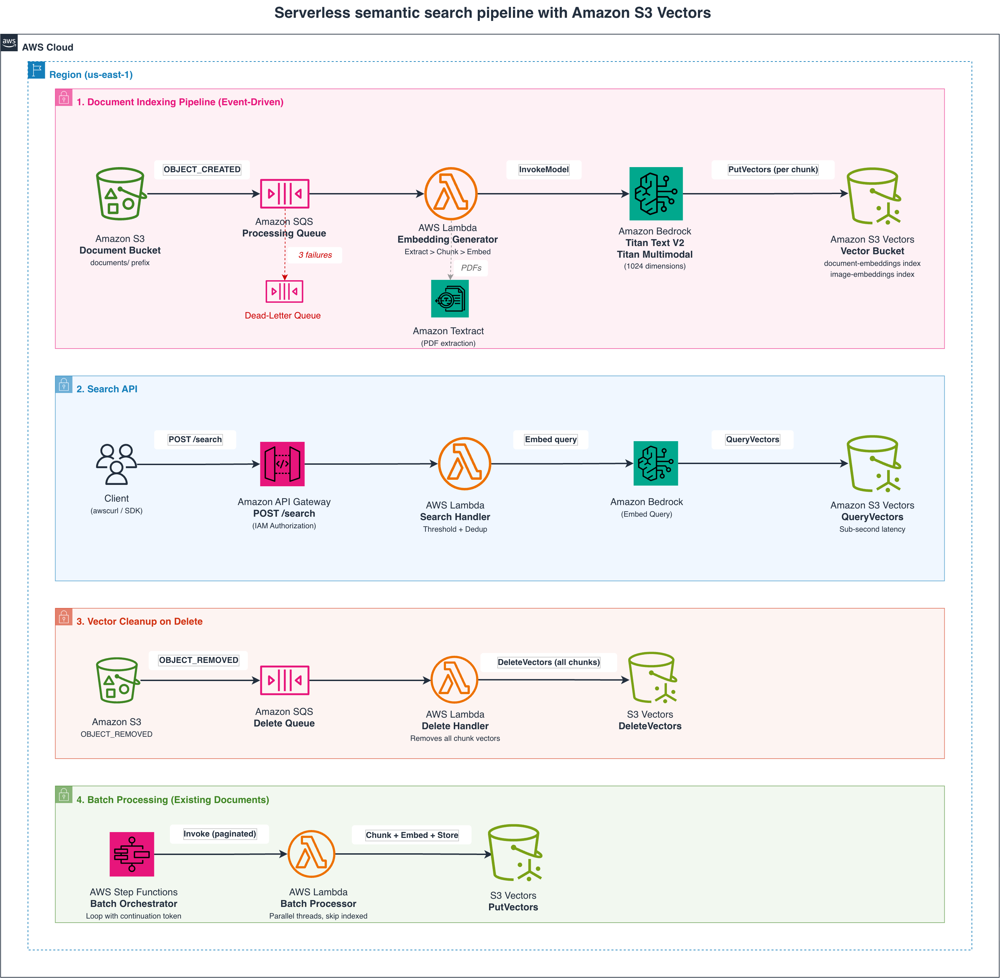

# Deployment & Cleanup Instructions

For the full solution architecture, see the [README](../README.md).



## Prerequisites

- AWS CLI v2 configured (`aws sts get-caller-identity` to verify)
- Python 3.11+
- AWS CDK v2 (`npm install -g aws-cdk`)
- boto3 >= 1.43.108 (`pip install "boto3>=1.43.108"`) - first release with the S3 Vectors index-mode APIs used for metadata pre-filtering
- Amazon Bedrock model access enabled for:
  - `amazon.titan-embed-text-v2:0` (required)
  - `amazon.titan-embed-image-v1` (optional, for multimodal search)

---

## Clean Up Previous Deployment

### 1. Get existing bucket names

```bash
DOC_BUCKET=$(aws cloudformation describe-stacks \
  --stack-name VectorSearchStack \
  --query 'Stacks[0].Outputs[?OutputKey==`DocumentBucketName`].OutputValue' \
  --output text)

VECTOR_BUCKET=$(aws cloudformation describe-stacks \
  --stack-name VectorSearchStack \
  --query 'Stacks[0].Outputs[?OutputKey==`VectorBucketName`].OutputValue' \
  --output text)
```

### 2. Empty the S3 bucket

```bash
# Delete all object versions
aws s3api list-object-versions --bucket $DOC_BUCKET --output json \
  --query '{Objects: Versions[].{Key:Key,VersionId:VersionId}}' | \
  aws s3api delete-objects --bucket $DOC_BUCKET --delete file:///dev/stdin

# Delete all delete markers
aws s3api list-object-versions --bucket $DOC_BUCKET --output json \
  --query '{Objects: DeleteMarkers[].{Key:Key,VersionId:VersionId}}' | \
  aws s3api delete-objects --bucket $DOC_BUCKET --delete file:///dev/stdin
```

For versioned buckets, delete all object versions:

```bash
aws s3api list-object-versions --bucket $DOC_BUCKET --output json \
  | python3 -c "
import sys, json
data = json.load(sys.stdin)
for v in data.get('Versions', []):
    print(f\"{v['Key']} {v['VersionId']}\")
for d in data.get('DeleteMarkers', []):
    print(f\"{d['Key']} {d['VersionId']}\")
" | while read key vid; do
  aws s3api delete-object --bucket $DOC_BUCKET --key "$key" --version-id "$vid"
done
```

### 3. Delete the vector index and vector bucket

```bash
aws s3vectors delete-index \
  --vector-bucket-name $VECTOR_BUCKET \
  --index-name document-embeddings

aws s3vectors delete-index \
  --vector-bucket-name $VECTOR_BUCKET \
  --index-name image-embeddings

aws s3vectors delete-vector-bucket \
  --vector-bucket-name $VECTOR_BUCKET
```

### 4. Destroy the CDK stack

```bash
cd code/infrastructure
cdk destroy --force
```

### 5. Remove retained bucket (if still exists)

The document bucket has `RemovalPolicy.RETAIN`, so it survives stack deletion:

```bash
aws s3 rb s3://$DOC_BUCKET --force
```

### 6. Verify cleanup

```bash
aws cloudformation describe-stacks --stack-name VectorSearchStack 2>&1 \
  | grep -q "does not exist" && echo "Stack deleted" || echo "Stack still exists"
```

---

## Deploy (Fresh)

### 1. Install dependencies

```bash
cd code/infrastructure
pip install -r requirements.txt
```

### 2. Bootstrap CDK (first time per account/region only)

```bash
cdk bootstrap
```

### 3. Deploy the stack

```bash
cdk deploy
```

Review the IAM changes and confirm when prompted.

### 4. Capture stack outputs

```bash
VECTOR_BUCKET=$(aws cloudformation describe-stacks \
  --stack-name VectorSearchStack \
  --query 'Stacks[0].Outputs[?OutputKey==`VectorBucketName`].OutputValue' \
  --output text)

DOC_BUCKET=$(aws cloudformation describe-stacks \
  --stack-name VectorSearchStack \
  --query 'Stacks[0].Outputs[?OutputKey==`DocumentBucketName`].OutputValue' \
  --output text)

API_URL=$(aws cloudformation describe-stacks \
  --stack-name VectorSearchStack \
  --query 'Stacks[0].Outputs[?OutputKey==`SearchAPIEndpoint`].OutputValue' \
  --output text)

SM_ARN=$(aws cloudformation describe-stacks \
  --stack-name VectorSearchStack \
  --query 'Stacks[0].Outputs[?OutputKey==`BatchStateMachineArn`].OutputValue' \
  --output text)
```

### 5. Verify vector setup

```bash
cd ../scripts
python enable_vector_search.py $VECTOR_BUCKET
```

---

## Test the Pipeline

### Upload sample documents (triggers automatic indexing)

```bash
# Navigate back to the code directory
cd ..

# Upload the included sample insurance claim documents
aws s3 cp examples/claim-folder/ s3://$DOC_BUCKET/documents/claims/ --recursive

# Upload sample damage photos (for multimodal image search)
aws s3 cp examples/damage-photos/ s3://$DOC_BUCKET/documents/images/ --recursive
```

Or upload any of your own documents (`.pdf`, `.txt`, `.md`, `.json`, `.jpg`, `.png`):

```bash
aws s3 cp <your-document.pdf> s3://$DOC_BUCKET/documents/<your-document.pdf>
```

Allow ~10-15 seconds for the Lambda to process, then check logs:

```bash
aws logs tail /aws/lambda/vector-search-embedding-generator --since 5m
```

### Run a semantic search

The API uses IAM auth, so use `awscurl` instead of plain `curl`:

```bash
pip install awscurl

# Text search
awscurl --service execute-api --region <your-region> \
  -X POST "${API_URL}search" \
  -H "Content-Type: application/json" \
  -d '{"query": "your search query here", "top_k": 5}'

# Image search (find images matching a text description)
awscurl --service execute-api --region <your-region> \
  -X POST "${API_URL}search" \
  -H "Content-Type: application/json" \
  -d '{"query": "vehicle rear bumper damage", "top_k": 5, "index": "image-embeddings"}'

# Image-as-query search (find visually similar images by uploading a photo)
# Note: large images exceed shell argument limits, so we write to a temp file
IMAGE_B64=$(base64 -i /path/to/your-photo.jpg)
echo "{\"query_image\": \"$IMAGE_B64\", \"top_k\": 5, \"index\": \"image-embeddings\"}" > /tmp/image-query.json
awscurl --service execute-api --region <your-region> \
  -X POST "${API_URL}search" \
  -H "Content-Type: application/json" \
  -d @/tmp/image-query.json
```

### Understanding distance thresholds

The search API applies a confidence threshold (default `0.75`) to filter low-relevance results. With cosine distance, **lower values mean higher similarity** (0 = identical).

Important: even when your query contains text that exists verbatim in a document, the distance will **not** be zero. This is because:

- Documents are chunked into ~1000 character segments before embedding
- The embedding captures the overall semantic meaning of the entire chunk, not individual phrases within it
- A short query phrase (e.g., "Crushed, requires full replacement") produces a different embedding than the full chunk that contains it, because the model weighs the surrounding context
- Typical cosine distances for semantically related content with Titan Text Embeddings V2:
  - Exact same full text: 0.0
  - A phrase vs. the paragraph containing it: 0.3-0.6
  - Semantically similar but differently worded: 0.4-0.7
  - Unrelated content: 0.8-1.0+

If you're getting no results, try increasing the threshold:

```bash
# Use a more permissive threshold to see all matches
awscurl --service execute-api --region <your-region> \
  -X POST "${API_URL}search" \
  -H "Content-Type: application/json" \
  -d '{"query": "vehicle collision damage", "top_k": 10, "distance_threshold": 0.9}'
```

The response includes `raw_matches` (total vectors found before threshold filtering) so you can tell if vectors exist but are being filtered out.

### Troubleshooting

If documents aren't showing up in search results, use these commands to diagnose:

```bash
# 1. Check if text vectors exist in the document index
aws s3vectors list-vectors \
  --vector-bucket-name $VECTOR_BUCKET \
  --index-name document-embeddings

# 2. Check if image vectors were stored in the image index
aws s3vectors list-vectors \
  --vector-bucket-name $VECTOR_BUCKET \
  --index-name image-embeddings

# 3. Check the embedding Lambda logs for errors
aws logs tail /aws/lambda/vector-search-embedding-generator --since 1h --format short

# 4. Check if messages are stuck in the DLQ
aws sqs get-queue-attributes \
  --queue-url $(aws cloudformation describe-stacks \
    --stack-name VectorSearchStack \
    --query 'Stacks[0].Outputs[?OutputKey==`DLQUrl`].OutputValue' \
    --output text) \
  --attribute-names ApproximateNumberOfMessages
```

Common issues:
- **No vectors in index**: Documents may not be under the `documents/` prefix, or the Lambda errored during processing.
- **DLQ has messages**: The embedding Lambda failed 3 times. Check the Lambda logs for the specific error (e.g., Bedrock model not enabled, IAM permission denied, Textract timeout).
- **Image errors with "doesn't support on-demand throughput"**: Ensure the multimodal model ID is `amazon.titan-embed-image-v1` (without the `:0` version suffix). The `:0` variant only supports provisioned throughput.

### Batch-process existing documents (optional)

```bash
cd ../scripts
python start_batch_processing.py $SM_ARN "documents/"
```

---

## Clean Up (After You're Done)

```bash
# Empty the document bucket (versioned - must delete all versions and delete markers)
aws s3api list-object-versions --bucket $DOC_BUCKET --output json \
  --query '{Objects: Versions[].{Key:Key,VersionId:VersionId}}' | \
  aws s3api delete-objects --bucket $DOC_BUCKET --delete file:///dev/stdin

aws s3api list-object-versions --bucket $DOC_BUCKET --output json \
  --query '{Objects: DeleteMarkers[].{Key:Key,VersionId:VersionId}}' | \
  aws s3api delete-objects --bucket $DOC_BUCKET --delete file:///dev/stdin

# Delete the vector indexes and vector bucket
aws s3vectors delete-index \
  --vector-bucket-name $VECTOR_BUCKET \
  --index-name document-embeddings

aws s3vectors delete-index \
  --vector-bucket-name $VECTOR_BUCKET \
  --index-name image-embeddings

aws s3vectors delete-vector-bucket \
  --vector-bucket-name $VECTOR_BUCKET

# Destroy the CDK stack
cd code/infrastructure
cdk destroy --force

# Remove the retained document bucket manually
aws s3 rb s3://$DOC_BUCKET --force
```
