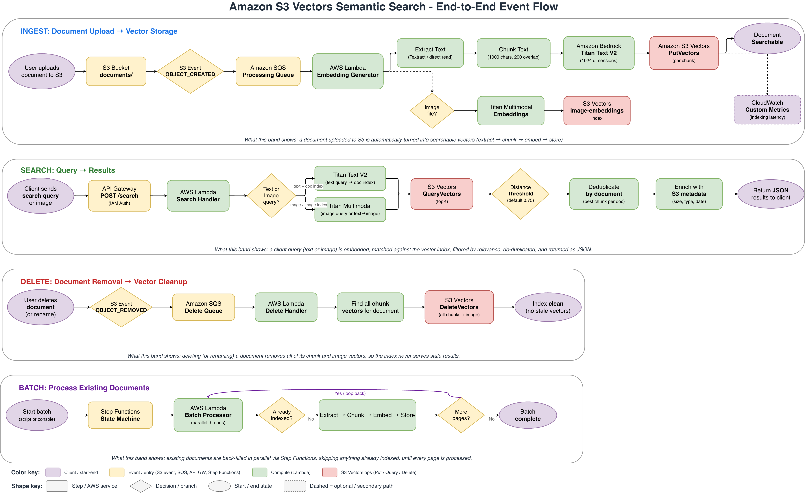

# S3 Vectors Semantic Search - Code

This directory contains the implementation code. See the [root README](../README.md) for full setup instructions and architecture diagrams.



## Quick Reference

```bash
# Deploy
cd infrastructure
pip install -r requirements.txt
cdk deploy

# Run unit tests
cd ..
pip install -r requirements-dev.txt
pytest tests/test_embedding_generator.py tests/test_search_handler.py -v

# Run end-to-end tests (requires deployed stack)
export S3_BUCKET=your-doc-bucket
export API_URL=https://your-api.execute-api.us-east-1.amazonaws.com/prod/
pytest tests/test_e2e_search.py -v

# Upload documents
aws s3 cp examples/claim-folder/ s3://$DOC_BUCKET/documents/claims/ --recursive

# Upload images (multimodal search)
aws s3 cp examples/damage-photos/ s3://$DOC_BUCKET/documents/images/ --recursive

# Search (text)
awscurl --service execute-api --region <your-region> \
  -X POST "${API_URL}search" \
  -H "Content-Type: application/json" \
  -d '{"query": "vehicle collision rear bumper damage", "top_k": 10}'

# Search (image index)
awscurl --service execute-api --region <your-region> \
  -X POST "${API_URL}search" \
  -H "Content-Type: application/json" \
  -d '{"query": "rear bumper damage photo", "top_k": 5, "index": "image-embeddings"}'
```

## Configuration

Key environment variables set by the CDK stack on each Lambda:

| Variable | Description | Default |
|----------|-------------|---------|
| `CHUNK_SIZE` | Characters per text chunk | 1000 |
| `CHUNK_OVERLAP` | Overlap between chunks | 200 |
| `DISTANCE_THRESHOLD` | Max cosine distance for results | 0.75 |
| `EMBEDDING_DIMENSIONS` | Vector dimensions | 1024 |
| `EMBEDDING_MODEL_ID` | Text embedding model | `amazon.titan-embed-text-v2:0` |
| `MULTIMODAL_MODEL_ID` | Image/multimodal embedding model | `amazon.titan-embed-image-v1` |
| `DEFAULT_TOP_K` | Default number of results | 10 |
| `IMAGE_INDEX_NAME` | Index for image embeddings | `image-embeddings` |

## CloudWatch Dashboard

After deployment, a pre-configured dashboard is available at:
`https://console.aws.amazon.com/cloudwatch/home#dashboards:name=S3VectorsSearchPipeline`

It tracks:
- Embedding generator latency (P50/P95/P99)
- Search handler latency (P50/P95)
- Lambda errors across all functions
- DLQ depth
- Custom indexing latency by file type
- Custom search latency

See [DEPLOYMENT.md](DEPLOYMENT.md) for detailed deployment and cleanup steps.
